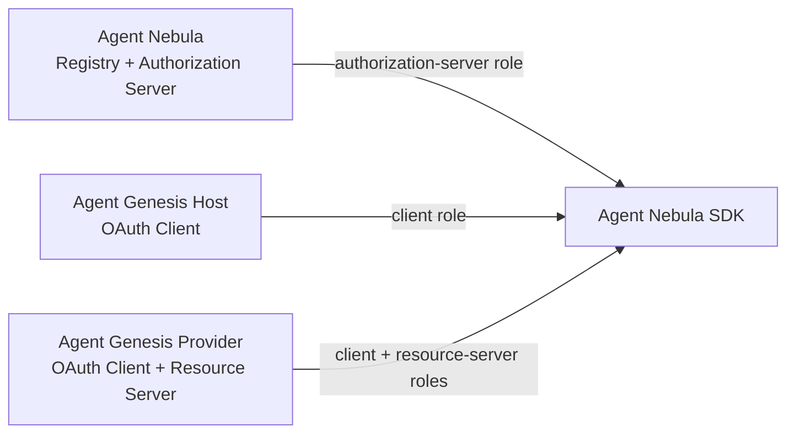
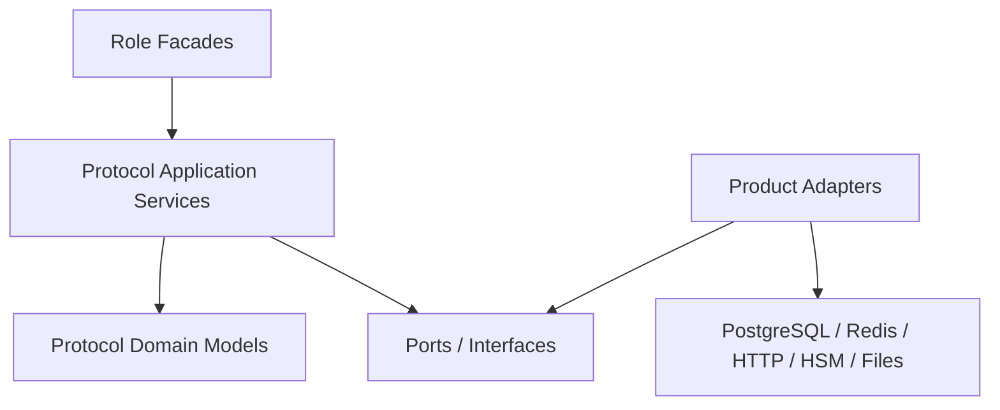

# Architecture

## System context

The SDK is a neutral standards library shared by two products:



The SDK depends on neither product. Products depend only on versioned SDK public APIs.

## Hexagonal architecture



## Protocol Runtime

`ProtocolRuntime` is the explicit product composition root. It stores configured role facades and additive protocol plugins under stable names while preserving the category-based package structure. It does not construct databases, HTTP transports, key stores, or global state.

## Role facades

- `OAuthClientFacade`: registration, RFC 7523 assertions, resource-token requests, DPoP request signing.
- `AuthorizationServerFacade`: registration validation, client authentication, resource resolution, token issuance, DPoP token-endpoint validation.
- `ResourceServerFacade`: RFC 9068 token validation, DPoP request validation, security-context construction.
- `A2ASecurityAdapter`: translates Agent Card security metadata and HTTP security context; identity never enters A2A payloads.
- `McpSecurityAdapter`: protected-resource metadata and OAuth authorization integration.

## Stable dependency rule

```text
Product route/controller
→ Product application service
→ SDK role facade
→ SDK protocol services
→ SDK ports
→ Product adapter
→ Product-owned infrastructure
```

No product may call SDK internal validators directly. No SDK module may import product code.
