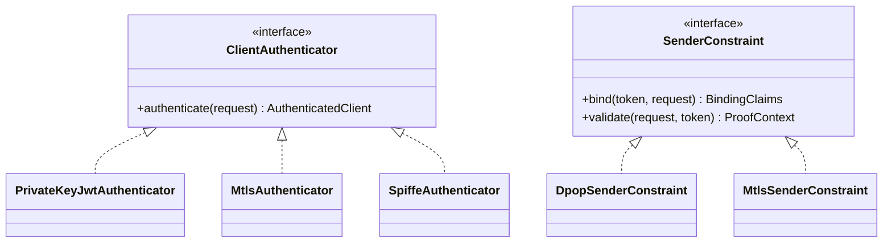

# Module and Plugin Model

## Rule: additive extension

A new protocol must be added as a new module and plugin implementation. Existing protocol code must not be edited to add unrelated behavior.



## Plugin registry

Plugins are selected by explicit configuration and registered through composition, not reflection or implicit import side effects.

```text
ProtocolPluginRegistry
├── client_authenticators
├── registration_profiles
├── resource_resolvers
├── token_profiles
├── sender_constraints
├── workload_identity_providers
├── authorization_detail_handlers
└── transport_adapters
```

Each plugin declares:

- unique identifier;
- standards implemented;
- supported roles;
- configuration model;
- required ports;
- incompatible plugins;
- startup validation hook.

Unsupported placeholders must raise `UnsupportedProtocolError` during composition.
