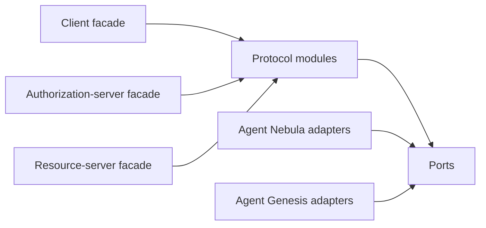

# SDK Overview

Agent Nebula SDK is a standards implementation shared by authorization servers, service clients, and protected resources. Its design follows dependency inversion: protocol services depend on ports, while products provide persistence, network, key-custody, and policy adapters.

## Roles

## Ownership

The SDK owns parsing, validation, cryptographic profiles, token construction, metadata models, and stable errors. Products own route composition, persistence, trust scoring, private keys, local policy, and business operations.
