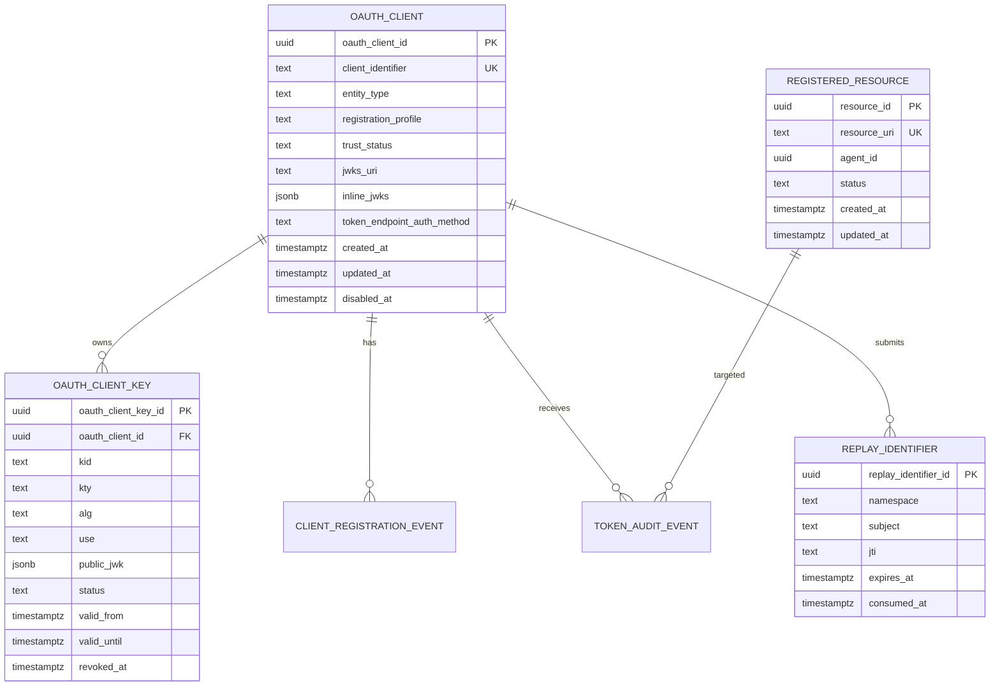

# Agent Nebula Schema Blueprint

This is a product schema blueprint, not an SDK-owned migration. Agent Nebula must map it to its schema-first database API.

## Core entities

## Schema design rules

- Schema SQL is the source of truth for DB types.
- XML query contracts reference real table columns.
- Domain commands use schema-aligned Python types.
- External strings are converted once at API/application boundaries.
- Repositories perform explicit mapping only.
- JSONB is reserved for protocol metadata whose shape is governed by an RFC model.
- Stable identifiers, statuses, timestamps, and relationships remain relational.

## Future additions without core-table redesign

- RFC 8705 certificate bindings: separate `oauth_client_certificate` table.
- SPIFFE: separate `workload_identity_binding` table.
- DID/VC: separate `decentralized_identity` and `credential_evidence` tables.
- RAR: JSONB authorization-detail audit linked to token event.
- GNAP: separate grant negotiation and continuation tables.
