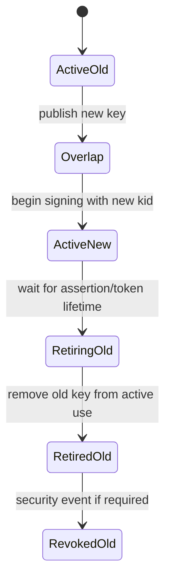

# Key Rotation

Rotation requirements:

- stable client identity across restart;
- unique `kid` per client;
- both keys available during overlap;
- unknown `kid` triggers one bounded JWKS refresh;
- old key removed only after all dependent artifacts expire;
- revocation is distinct from normal retirement.
