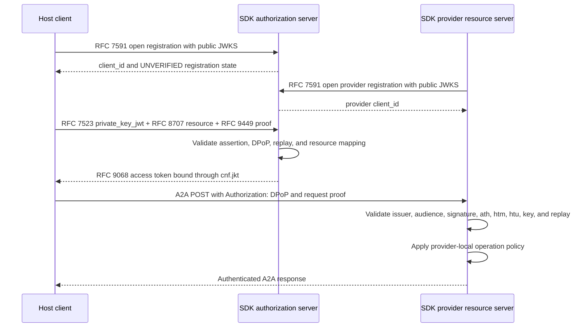

# Step 10 — SDK-only Host → Registry → Provider acceptance flow

## Purpose

Step 10 proves that the Phase 1 protocol modules compose through their public
role facades without Agent Nebula or Agent Genesis product code.

## Verified sequence



## Implementation

The reusable harness is exposed as:

```python
from agent_nebula_sdk.conformance import Phase1AcceptanceHarness

result = Phase1AcceptanceHarness().run()
```

The harness uses only SDK public roles plus reference in-memory adapters. The
bridge from RFC 7591 records to RFC 7523 key resolution explicitly represents
the PostgreSQL adapter that Agent Nebula will provide during product
integration.

## Negative acceptance checks

The acceptance suite verifies rejection of:

- a replayed RFC 7523 client assertion;
- a DPoP-bound token used with a different private key;
- a proof used with the wrong HTTP method;
- a replayed protected-resource DPoP proof.

Existing protocol tests also cover wrong audience, wrong URI, incorrect `ath`,
expired assertions and tokens, unknown `kid`, invalid algorithms, malformed
metadata, and registration failures.

## Product boundary

The harness is not a deployable authorization server. It does not own database
schemas, HTTP routes, private-key custody, trust scoring, or provider business
policy. Those remain adapters in Agent Nebula and Agent Genesis.
