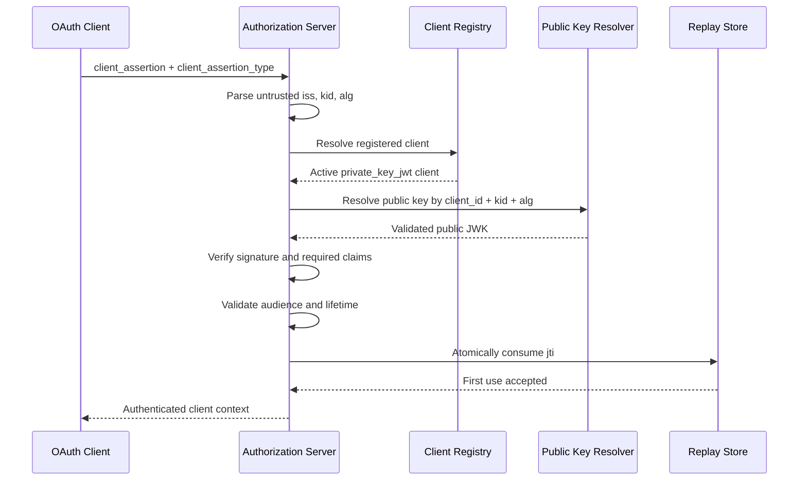

# Step 3 — RFC 7523 JWT Assertions

## Scope

Step 3 implements both protocol roles defined by RFC 7523:

1. JWT assertions used for OAuth client authentication (`private_key_jwt`).
2. JWT bearer assertions used as OAuth authorization grants.

Agent Nebula Phase 1 uses the client-authentication role. The authorization-grant
role is included as an independent plugin because it is part of RFC 7523 and may
be required by later federation profiles.

## Implemented profile

- RFC 7521 assertion parameter names and registered URNs.
- Required `iss`, `sub`, `aud`, and `exp` claims.
- Phase 1-required `iat` and `jti` claims.
- Exact token-endpoint audience validation.
- Configurable asymmetric algorithm allowlist.
- Required `kid` for deterministic key rotation.
- Registered-client lookup and active-state validation.
- Registered `private_key_jwt` authentication-method validation.
- Maximum assertion lifetime and clock-skew enforcement.
- Atomic replay-store port and thread-safe in-memory adapter.
- Client and authorization-grant builders.
- Client and authorization-grant authorization-server validators.
- Stable SDK errors instead of leaked PyJWT exceptions.

## Processing order

## Security invariants

- Untrusted claims are used only to locate records; no authentication decision is
  made before signature verification.
- The accepted algorithm comes from explicit policy, never from the JWT alone.
- A registered JWK `alg` must match the protected header when present.
- `iss` and `sub` must identify the same client for client authentication.
- Assertions are short-lived and single-use.
- Product persistence remains outside the SDK through typed ports.

## Deferred work

RFC 7591 registration is Step 4 and will create the registered-client and key
records consumed by this module. DPoP and access-token profiles remain separate
modules and do not alter RFC 7523 processing.
