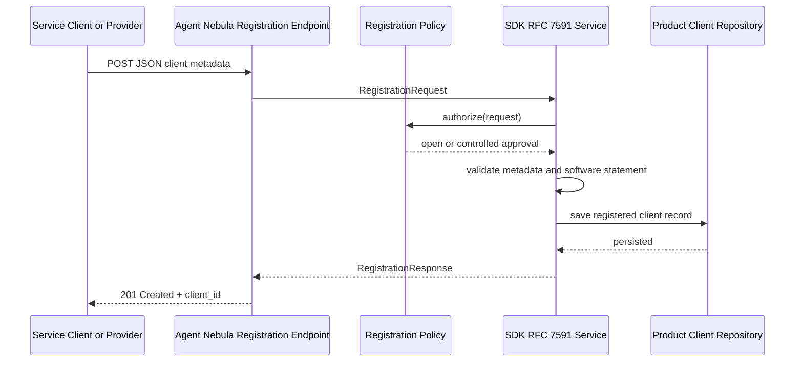

# Step 4 — RFC 7591 Dynamic Client Registration

## Scope

The SDK implements both client-side and authorization-server-side RFC 7591 processing. It supports open registration, protected registration with an initial access token, inline JWKS, `jwks_uri`, standard client metadata, software statements through a verifier port, extension metadata, and persistence-neutral registration records.

## Registration flow

## Product-specific extensions

RFC 7591 permits additional metadata members. The SDK preserves them and delegates acceptance to `RegistrationPolicy.validate_extensions()`. Agent Nebula can therefore add entity classification or publisher references without changing the RFC module.

## Deliberate profile decisions

- No generated client secret for the Phase 1 Agent Nebula profile; RFC 7523 `private_key_jwt` is used after registration.
- Open registrations receive `UNVERIFIED` trust status.
- Controlled registrations use an initial access token through a policy adapter.
- Duplicate software identity enforcement is optional because RFC 7591 does not require uniqueness.
- RFC 7592 registration management is implemented as the additive `oauth/rfc7592` module.
