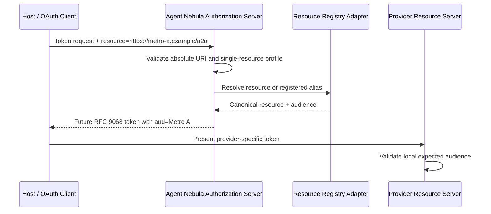

# Step 5 — RFC 8707 Resource Indicators

## Goal

Allow OAuth clients to identify the protected resource where an access token
will be redeemed and allow Agent Nebula to select an exact provider audience.

## Flow

## Implemented responsibilities

- standards-level support for one or multiple resource values;
- secure Agent Nebula profile requiring exactly one HTTPS resource;
- absolute URI and fragment validation;
- optional query-component and scheme policy;
- duplicate indicator rejection;
- RFC 8707 `invalid_target` errors;
- registered resource and alias resolution;
- resource-to-audience mapping;
- prior authorization-grant subset validation;
- repeated form-parameter and JWT string/array codecs;
- provider-side audience membership validation.

## Boundaries

The SDK does not persist providers or resources. Agent Nebula implements the
`ResourceRegistry` port using its schema-backed DB layer. Access-token signing
is intentionally deferred to Step 6 (RFC 9068), while Step 5 produces the
validated audience input required by that issuer.
