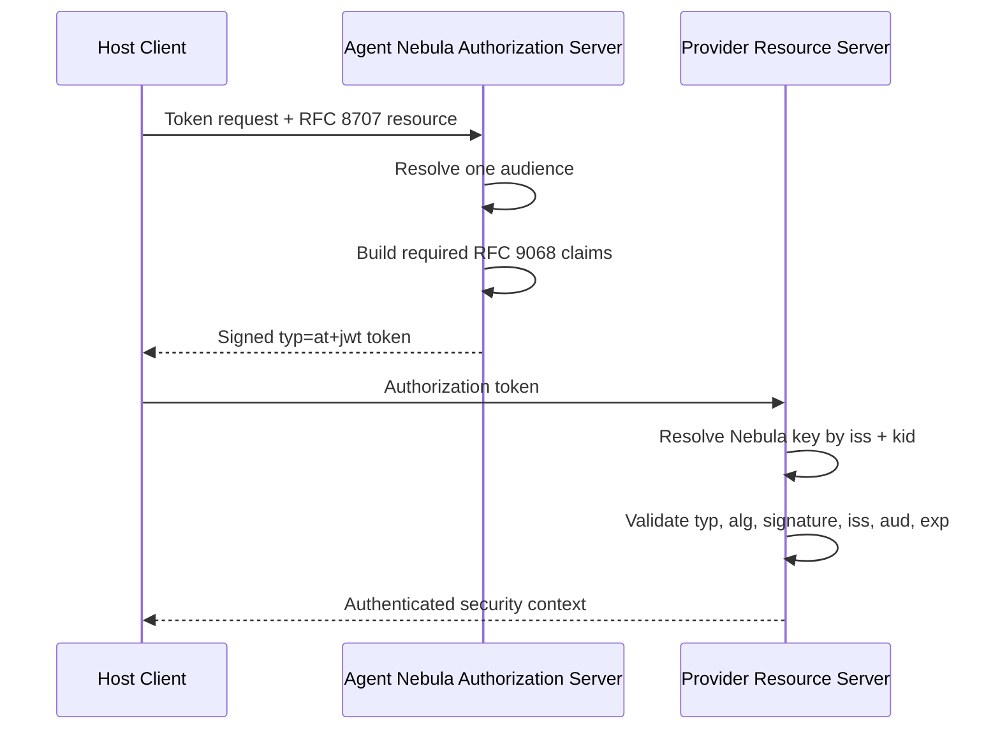

# Step 6 — RFC 9068 JWT Access Tokens

## Flow

The issuer and validator are persistence-neutral. Agent Nebula supplies private
signing keys and Provider Agents resolve public keys from Nebula JWKS metadata.
