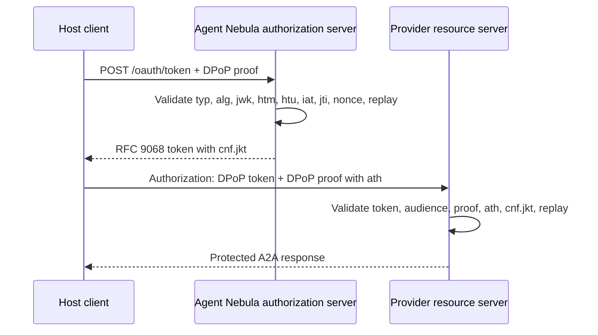

# Step 7 — RFC 9449 DPoP

## Purpose

Step 7 adds sender-constrained OAuth access tokens. A stolen access token is
not sufficient for invocation because the caller must also sign a fresh proof
with the private key whose RFC 7638 thumbprint appears in the token's
`cnf.jkt` claim.

## Implemented flow

## Components

- `DpopProofBuilder`: request-specific proof construction.
- `DpopProofValidator`: token-endpoint and resource-server validation.
- `DpopTargetUriNormalizer`: RFC 9449 `htu` comparison semantics.
- `AccessTokenHashService`: `ath` calculation.
- `DpopTokenBindingService`: `cnf.jkt` claim integration.
- `DpopNonceService`: optional server nonce issuance.
- `DpopHttpHeaderCodec`: `Authorization: DPoP`, `DPoP`, and `DPoP-Nonce` headers.
- `DpopReplayStore` and `DpopNonceStore`: product persistence ports.

## Persistence boundary

The SDK has no database. Agent Nebula and distributed providers must implement
atomic replay and nonce stores with PostgreSQL, Redis, or equivalent storage.
The in-memory implementations are reference adapters for tests and single-node
local execution only.

## Deferred to product integration

- FastAPI/ASGI middleware composition.
- Redis/PostgreSQL replay adapters.
- Token and resource endpoint HTTP routes.
- Operational nonce-challenge policy.
- Provider-local authorization decisions.
