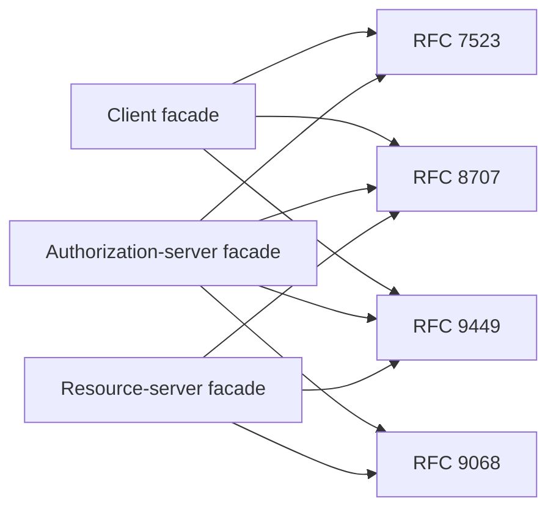

# Step 8 — Role facades

Step 8 composes the Phase 1 RFC modules into three stable product-facing roles:

- `OAuthClientFacade` for Host and Provider OAuth-client behavior;
- `AuthorizationServerFacade` for Agent Nebula registration and token issuance;
- `ResourceServerFacade` for Provider token and DPoP validation.

The facades are deliberately thin. They preserve RFC-specific request and result models, accept all infrastructure as injected collaborators, and contain no database, HTTP route, trust-score, or provider business-policy implementation.

