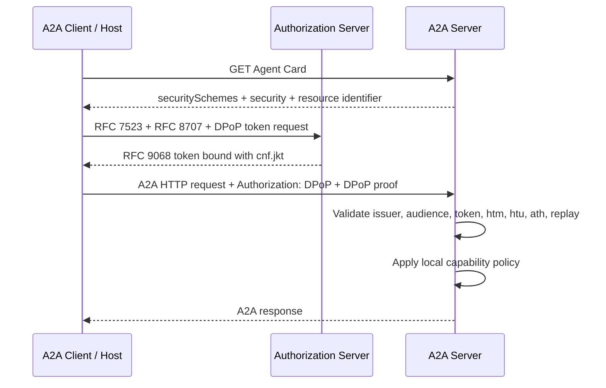
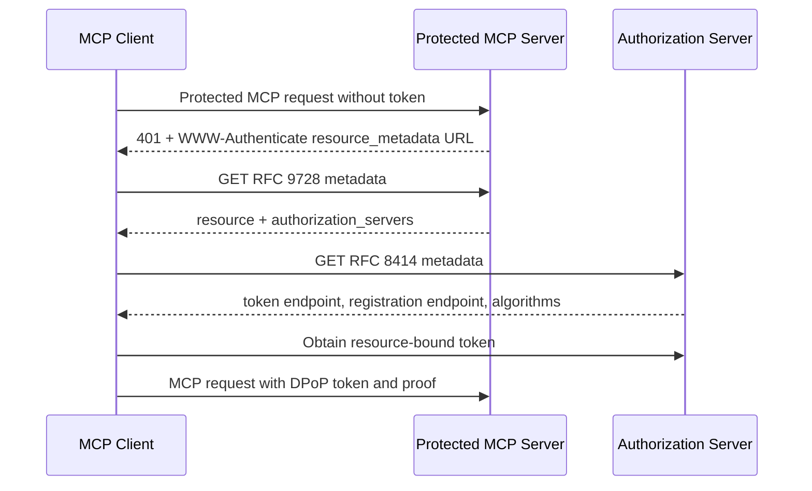

# Step 9 — A2A and MCP Security Adapters

## Goal

Connect the completed OAuth client and resource-server roles to A2A and MCP
without creating custom token formats or embedding identity into protocol
payloads.

## A2A flow

## MCP discovery flow

## Security boundaries

- A2A and MCP adapters never authorize business operations.
- Provider-local policy receives a trusted `ResourceSecurityContext`.
- Metadata resource and issuer identifiers are matched exactly.
- All discovery URLs use HTTPS and are fetched through an injected transport.
- Redirect, DNS, and network-egress policy remain deployment responsibilities.
