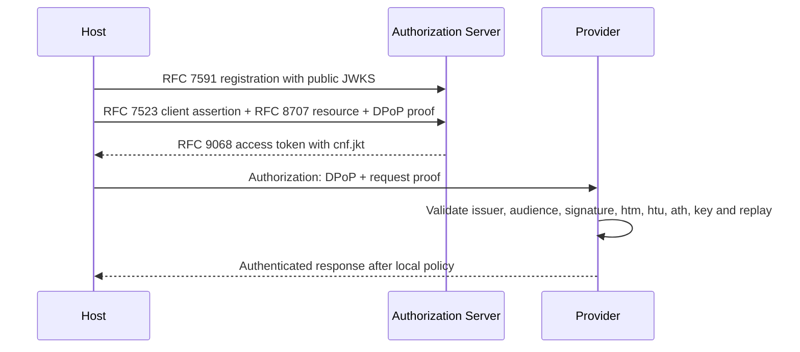

# Phase 1 Completion Report

## Result

Phase 1 is complete at the SDK level. The implementation supports open client and provider registration, asymmetric authentication, exact provider targeting, signed JWT access tokens, DPoP sender constraint, authorization metadata, and protected A2A/MCP invocation.

## Acceptance flow

## Completed modules

- JOSE key models, thumbprints, JWKS retrieval, caching, and rotation;
- RFC 7523 assertion builder and authenticator;
- RFC 7591 registration client/server services and policies;
- RFC 8707 resource validation and audience resolution;
- RFC 9068 issuer and validator;
- RFC 9449 proof builder, validator, nonce, binding, and replay ports;
- RFC 8414 and RFC 9728 metadata;
- client, authorization-server, and resource-server facades;
- A2A and MCP HTTP security adapters;
- SDK-only conformance harness.

## Quality baseline

The Step 10 baseline reported 232 passing tests, strict typing, Ruff format/lint success, documentation audit success, compilation success, and branch coverage above 90 percent.

## Known limits

Phase 1 does not include mTLS, certificate-bound tokens, SPIFFE/SPIRE, registration management, RAR, DID/VC, GNAP, federation, or product persistence adapters. These are deliberately assigned to later phases.

## Production integration required

Agent Nebula must provide PostgreSQL/Redis adapters, signing-key custody, routes, trust scoring, and audit. Agent Genesis must provide persistent private keys, token caching, provider replay storage, and local authorization policy.
